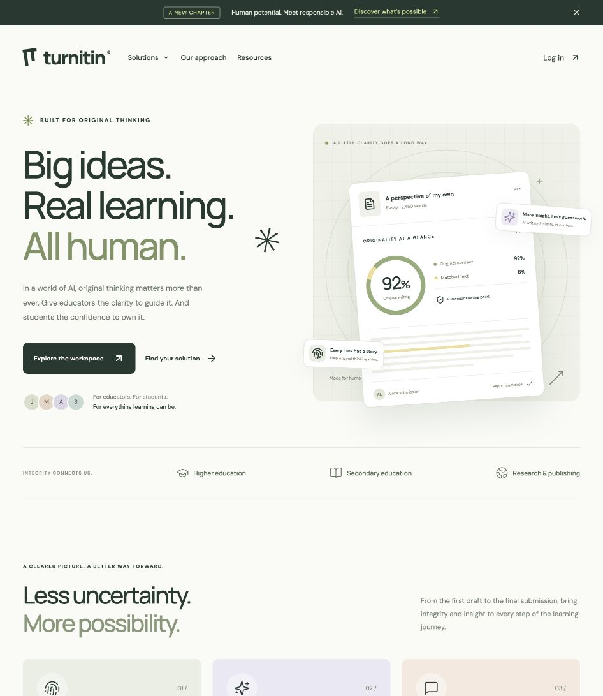

# AcadGuard AI: An Intelligent Academic Integrity Platform for Plagiarism Detection, Semantic Similarity Analysis, and Citation Verification
A pnpm and Turborepo workspace containing the React frontend and the Rust plagiarism detection engine. The frontend uses Clerk authentication and includes a marketing site and educator workspace.

**This is an independent prototype, not an official Turnitin service.** Authentication is real and provided by Clerk. Documents, originality scores, AI indicators, and reports remain illustrative. The Rust engine runs locally through its CLI. The browser does not call it yet, and browser submissions are not transmitted or analyzed. AI detection is not implemented. Turnitin and its product names belong to their respective owners.



## Run locally

Requires Node.js 22.13+, pnpm 11.10.0, and a Rust toolchain with Cargo for engine commands. The imported engine was validated with Rust 1.97.1. Install the pinned pnpm version with Corepack or follow the [pnpm installation guide](https://pnpm.io/installation).

```sh
corepack enable
corepack install
pnpm install --frozen-lockfile
cp apps/web/.env.example apps/web/.env.local
```

Put your Clerk publishable key in `apps/web/.env.local`. Keep an existing working environment file. If migrating an older checkout, move its root `.env.local` to `apps/web/.env.local`.

```sh
pnpm dev
```

Open the local URL printed by Vite, normally http://127.0.0.1:5173/.

```sh
pnpm check      # TypeScript and both Rust crates, including test/example targets
pnpm test       # Browser routing tests and Rust unit, CLI, and doc tests
pnpm build      # Web bundle and Rust release binary
pnpm build:web  # Web bundle only; no Rust toolchain needed
pnpm preview    # Serve apps/web/dist locally
```

The browser build performs strict TypeScript checking and writes `apps/web/dist/`. The engine binary is `packages/plagengine/target/release/plagengine`. Turborepo caches web tasks, with `VITE_*` settings and web environment files included in build inputs. Cargo manages its own incremental artifacts; Rust tasks bypass Turbo caching to avoid reusing native results across toolchains and platforms. Turbo's cache stays in this checkout's `.turbo/cache`.

The frontend uses TypeScript 5.9.

## Plagiarism engine

Both Rust crates, their dependency lockfile, tests, evaluation tools, and demo corpus were imported from `/home/shujanforge/Projects/plagenine` into `packages/plagengine`. The source directory is unchanged.

- `plagengine-core` extracts TXT, Markdown, PDF, and DOCX documents, normalizes text, fingerprints token sequences with winnowing, retrieves candidates from a redb index, aligns passages, attributes overlapping sources, and produces filtered similarity reports.
- It classifies quotations and citations and flags hidden text, homoglyph replacements, and invisible character manipulation.
- `plagengine` exposes ingestion, checking, saved report filtering, source inspection, and PAN/adversarial evaluation through the CLI.

```sh
pnpm engine --help
pnpm demo:engine
pnpm engine --db /tmp/acadguard-example.db stats
```

The demo creates its own local index and reports under `packages/plagengine/examples/demo/`. Generated databases, reports, and build artifacts are ignored by Git. All Cargo scripts use the imported `Cargo.lock` with `--locked`.

See the [engine README](packages/plagengine/README.md) for CLI examples, the report schema, algorithm details, evaluation results, and limitations. The engine compares against sources you ingest; it does not search the web or provide semantic or AI writing detection. Browser-to-engine API integration remains future work.

## Clerk configuration

This is a React + Vite app, so browser configuration uses `VITE_` variables rather than Next.js `NEXT_PUBLIC_` variables:

| Supplied setting                      | Vite setting                   | Default          |
| ------------------------------------- | ------------------------------ | ---------------- |
| `NEXT_PUBLIC_CLERK_PUBLISHABLE_KEY`   | `VITE_CLERK_PUBLISHABLE_KEY`   | Required         |
| `NEXT_PUBLIC_CLERK_SIGN_IN_URL`       | `VITE_CLERK_SIGN_IN_URL`       | `/auth/login`    |
| `NEXT_PUBLIC_CLERK_SIGN_UP_URL`       | `VITE_CLERK_SIGN_UP_URL`       | `/auth/register` |
| `NEXT_PUBLIC_CLERK_AFTER_SIGN_IN_URL` | `VITE_CLERK_AFTER_SIGN_IN_URL` | `/dashboard`     |
| `NEXT_PUBLIC_CLERK_AFTER_SIGN_UP_URL` | `VITE_CLERK_AFTER_SIGN_UP_URL` | `/dashboard`     |

- Only the publishable key is used by this frontend. `CLERK_SECRET_KEY` is not needed, stored, bundled, or committed. Keep it in your Rust server environment when server integration is added.
- `.env*` files are ignored by Git, except for the placeholder-only `.env.example`.
- `ClerkProvider` supplies session state, themed sign-in/sign-up, user account management, and sign-out. The sign-in methods shown are controlled by the existing Clerk application's settings.
- `/dashboard` and every child route wait for Clerk to load, then require a signed-in session. Signed-out visitors return to sign-in with their intended workspace URL preserved.
- The landing page is public. Visiting sign-in or registration while signed in returns to the workspace.
- Sign-out returns to `/`. Authenticated users see their Clerk name and account menu in the workspace.
- Use a development publishable key for local testing and a production key for a configured production instance. Never prefix a Clerk secret key with `VITE_`.

Reference: [Clerk React quickstart](https://clerk.com/docs/react/getting-started/quickstart) and [custom sign-in/sign-up pages](https://clerk.com/docs/react/guides/development/custom-sign-in-or-up-page).

## Screens

| Route                    | Experience                                                                               |
| ------------------------ | ---------------------------------------------------------------------------------------- |
| `/`                      | Public landing page with audience tabs, solutions, product ecosystem, resources, and FAQ |
| `/auth/login/*`          | Clerk sign-in and nested authentication steps                                            |
| `/auth/register/*`       | Clerk registration and verification steps                                                |
| `/dashboard`             | Protected educator overview and recent submissions                                       |
| `/dashboard/submissions` | Searchable sample submissions and local demo file selection                              |
| `/dashboard/reports`     | Originality report list and detailed report reader                                       |
| `/dashboard/ai`          | Sample AI writing indicators with contextual guidance                                    |
| `/dashboard/classes`     | Classes, assignments, and class-specific submission search                               |
| `/dashboard/feedback`    | Sample document, editable feedback, and review checklist                                 |
| `/dashboard/resources`   | Educational guides and article dialogs                                                   |
| `/dashboard/settings`    | Demo workspace preferences; use the Clerk account menu for actual account settings       |

Old links such as `/#/app/reports` redirect to the matching protected `/dashboard/reports` route. They do not bypass authentication.

## Demo data and persistence

- All students, documents, classes, scores, source matches, highlights, and activity are illustrative.
- File selection accepts PDF, DOCX, and TXT up to 20 MB. Only filename and size are used. Files are not read, sent, stored, or analyzed.
- Adding a submission generates fixed demo scores.
- Submission, feedback, and workspace preference state is in React memory and resets on refresh or leaving the workspace. Clerk handles the actual user session separately.
- Passwords and session credentials are handled by Clerk. The application does not implement custom password storage.
- Dates and assignment schedules are fixed sample content for October 2026.
- Google Fonts loads DM Sans and Manrope; system fallbacks work offline. Icons use Lucide. Visual compositions are CSS and inline SVG.

## Structure

```text
apps/web/
  package.json              React + Vite package and browser commands
  .env.example              Public Clerk configuration template
  src/
    App.tsx                 Browser routes and page selection
    main.tsx                React, router, and auth entry point
    auth/                   Clerk provider, route guards, redirect tests
    components/             Brand and report preview components
    pages/                  Landing, login, and demo workspace screens
    styles.css              Shared visual system and responsive styles
  public/favicon.svg        Custom concept favicon
packages/plagengine/
  package.json              Cargo commands exposed to pnpm and Turbo
  Cargo.toml                Rust workspace
  Cargo.lock                Locked Rust dependencies
  crates/core/              Detection algorithms, extraction, index, reports
  crates/cli/               CLI and end-to-end tests
  examples/demo/            Local corpus, sample essay, demo script
  README.md                 Engine usage, report format, evaluations
  PLAN.md                   Original engine design notes
docs/                       UI previews, fixtures, verification history
pnpm-workspace.yaml         pnpm packages and allowed dependency builds
pnpm-lock.yaml              Locked JavaScript dependencies
turbo.json                  Build, check, test, and development tasks
vercel.json                 Web-only build and SPA rewrites
```

## Hosting and future Rust backend integration

Browser routes need an SPA fallback: serve `index.html` for `/auth/*` and `/dashboard/*`, while serving asset files normally. Vite's development and preview servers support this automatically. Set the public environment variables in the hosting service before building. The checked-in `vercel.json` expects the repository root, installs with pnpm, runs `pnpm build:web`, and serves `apps/web/dist`. It does not build or host the Rust CLI.

The route guard protects the UI only. Once the Rust backend is connected, validate Clerk session JWTs on **every protected API endpoint** before accessing data; frontend route guards do not authorize server requests. Replace the in-memory documents and feedback with authenticated API calls at that stage. The Rust engine is available as a local library and CLI; an authenticated HTTP API is not included.

## Content reference

The public [Turnitin homepage](https://www.turnitin.com/) informed the product themes: learning integrity, similarity, AI writing insights, feedback, research integrity, grading, and secure assessment. The internal workspace is an original conceptual design, not a reproduction of a private Turnitin account. Marketing copy was rewritten for this prototype.
